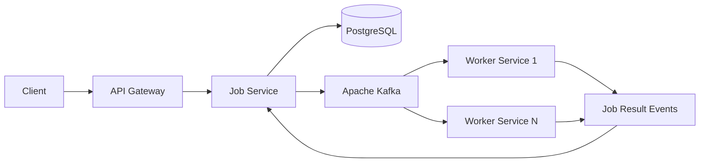

# Distributed Job Orchestration Platform

> An event-driven backend system for accepting, scheduling, distributing, retrying, and tracking asynchronous jobs across multiple worker services.

[](https://github.com/GururajBiradar001/distributed-job-platform/actions/workflows/ci.yml)

## Why this project?

This project is intentionally built around **backend engineering and distributed-systems problems**, rather than a generic CRUD application.

The platform models how a job can move from an API request through durable persistence and an event stream to independent workers, while handling retries, duplicate delivery, worker failure, and observability.

## Architecture



### Services

| Service | Responsibility |
|---|---|
| **API Gateway** | Entry point for client requests and service routing |
| **Job Service** | Job creation, persistence, state management and event publishing |
| **Worker Service** | Consumes jobs and performs asynchronous execution |
| **Kafka** | Event streaming and decoupling between producers and workers |
| **PostgreSQL** | Durable job state and metadata |

## Engineering Concepts Demonstrated

- Event-driven architecture with **Apache Kafka**
- Microservice separation with Spring Boot
- Priority-aware job processing
- Retry and backoff handling
- Idempotency and duplicate-delivery protection
- Distributed job claiming
- Worker lease / heartbeat concepts
- Dead-letter handling
- Transactional persistence with **Spring Data JPA / Hibernate**
- PostgreSQL persistence
- REST APIs
- Spring Boot Actuator and Micrometer/Prometheus metrics
- Dockerized local infrastructure
- Maven multi-module project structure

## Technology Stack

**Java 21 · Spring Boot 4.1.1 · Spring Web · Spring Data JPA · Hibernate · Spring Kafka · Apache Kafka · PostgreSQL · Docker · Maven · Actuator · Micrometer/Prometheus**

## Repository Structure

```text
.
├── api-gateway/       # API entry point
├── job-service/       # Job lifecycle + persistence + Kafka publishing
├── worker-service/    # Asynchronous job execution
├── docker-compose.yml # Local Kafka + PostgreSQL + services
└── pom.xml            # Maven multi-module build
```

## Run Locally

### Prerequisites

- Java 21+
- Docker Desktop
- Git

### Start the complete system

```bash
docker compose up --build
```

The Compose setup starts PostgreSQL, Kafka, the Job Service, and the Worker Service together. The repository's Compose configuration wires the services to the internal Docker hostnames used by the application.

### Build without Docker

```bash
./mvnw -DskipTests package
```

On Windows:

```powershell
.\mvnw.cmd -DskipTests package
```

## Observability

The Job Service exposes Spring Boot Actuator endpoints for health and metrics. Prometheus-compatible metrics are enabled through Micrometer.

## Project Status

The repository contains the core microservice structure and local Docker-based environment. The project is being developed incrementally, with distributed-systems concerns added as separate engineering milestones.

## What I Focused On

The main goal of this project is to demonstrate **why distributed systems need coordination mechanisms**: persistence protects job state, Kafka decouples producers from consumers, idempotency handles duplicate delivery, retries handle transient failures, and worker leases/heartbeats address worker failure.

This makes the project a practical demonstration of backend architecture rather than only a collection of REST endpoints.
